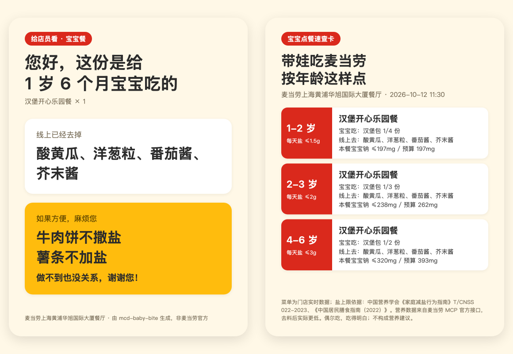
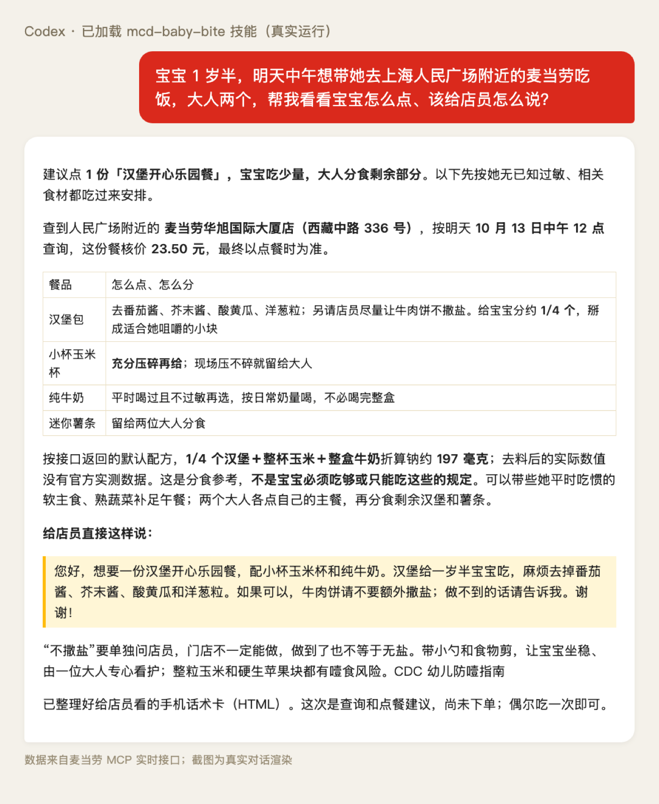
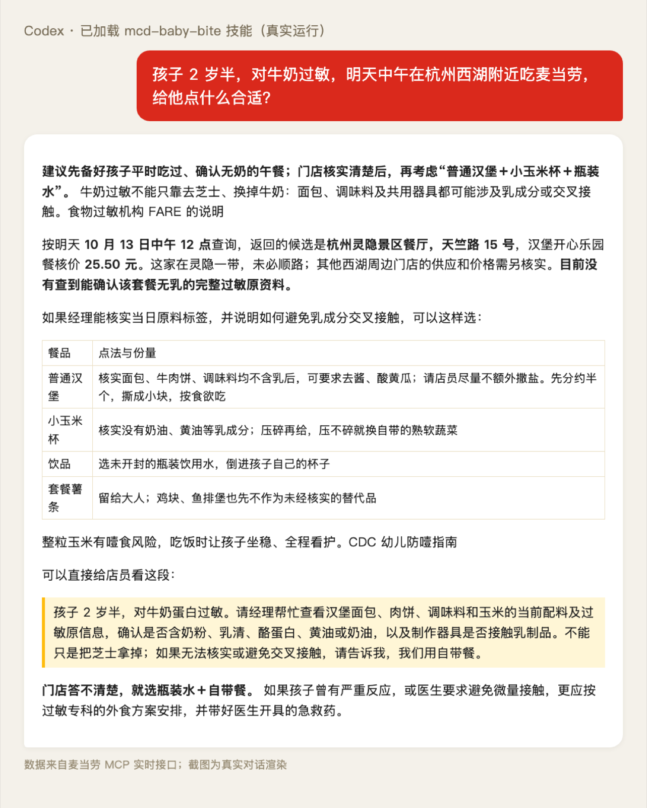
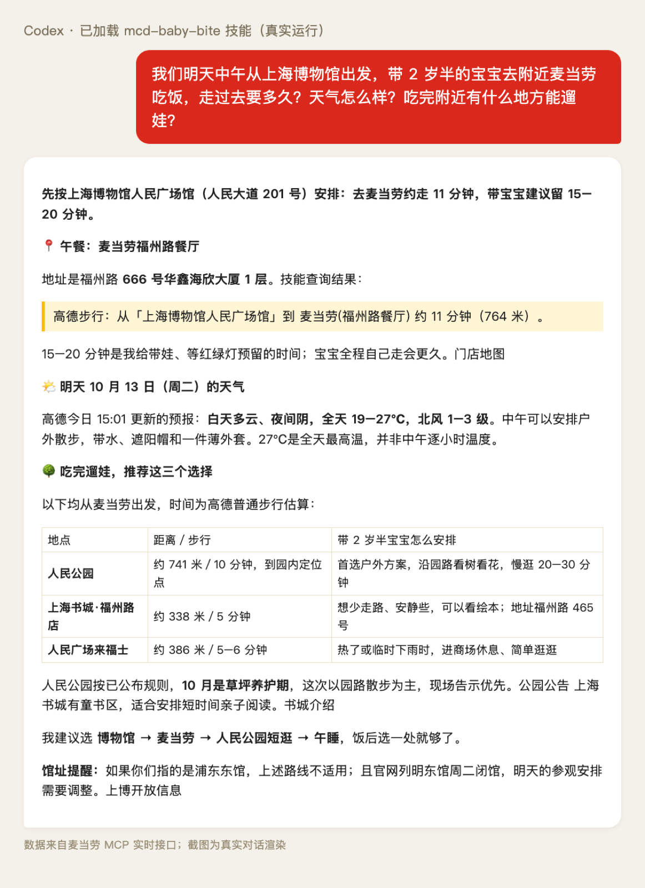
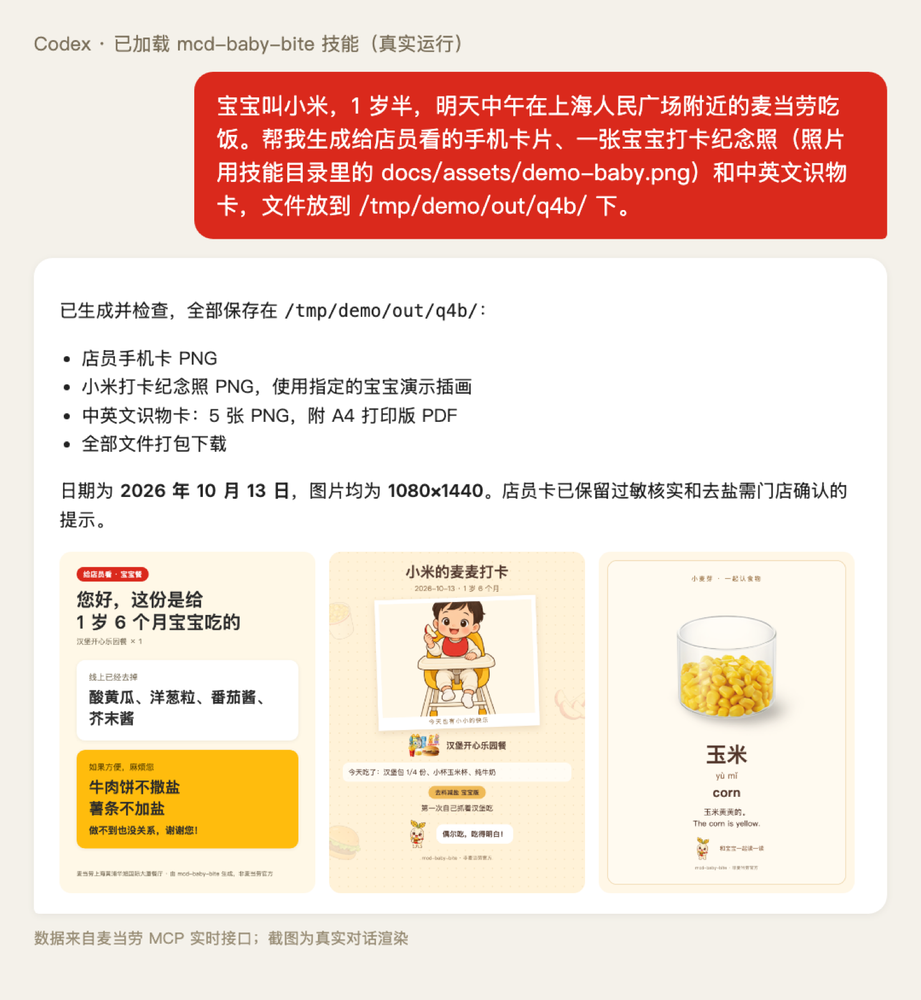
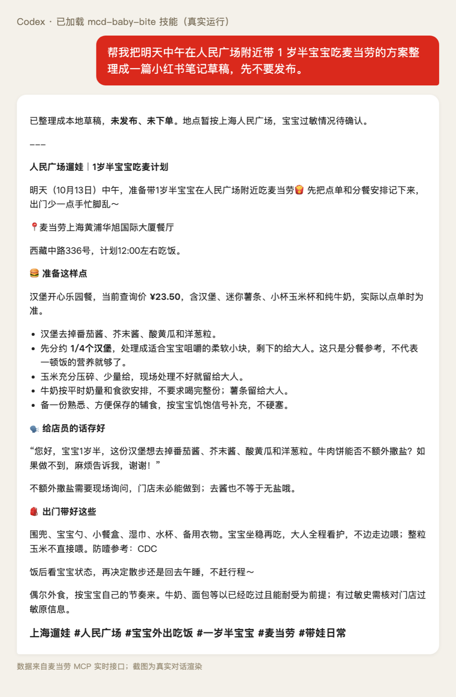
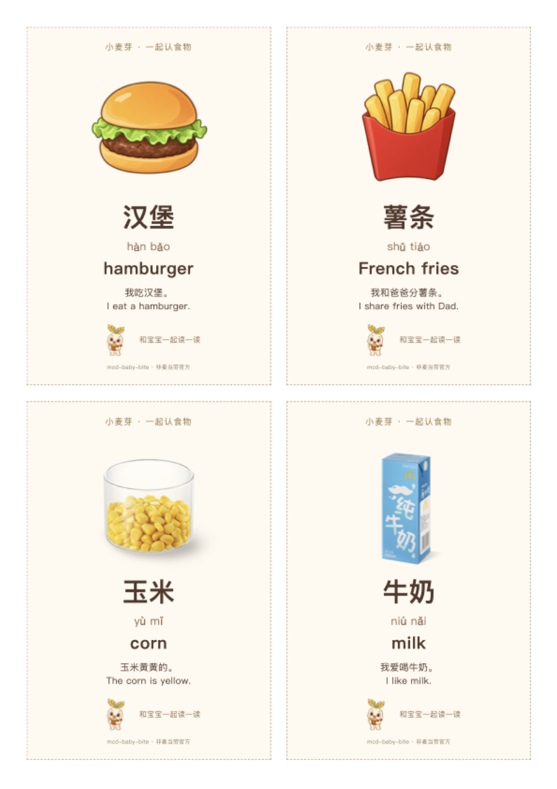
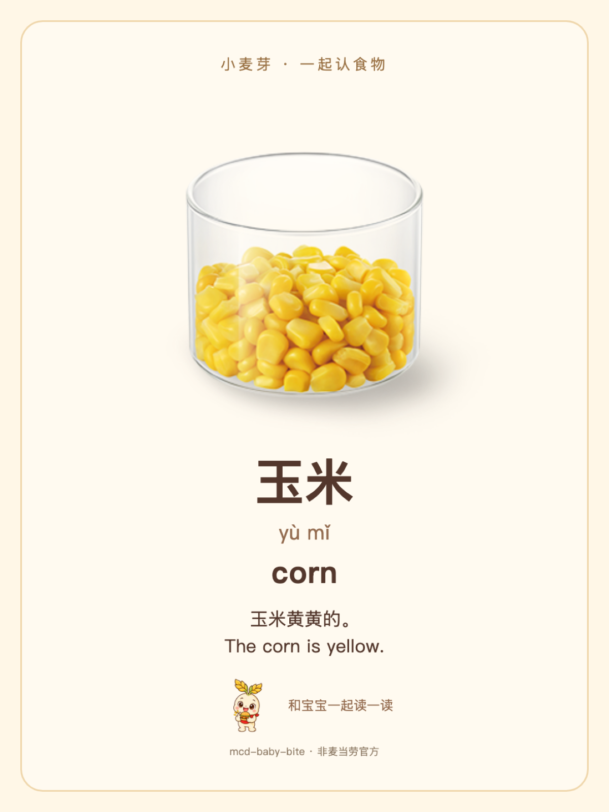

# 小小麦门 · 带娃吃麦定制官（mcd-baby-bite）

> 带 1-3 岁的宝宝吃麦当劳，到底该怎么点？
> 一句"宝宝 1 岁半，在人民广场附近"，它从**门店实时菜单**里挑出宝宝餐，**线上能去的配料自动去掉**，线上去不掉的盐变成一张**给店员看的话术卡**，再参考**年龄分档的减盐建议**计算宝宝这一餐的分餐份量。吃完还能生成**打卡纪念照**和**中英文识物卡**，顺路找到**饭后遛娃**的地方。

麦当劳程序员创意开发大赛参赛作品 · 基于麦当劳 MCP · 联动高德地图 MCP 与小红书 MCP · 零依赖 Python · 可作为 Agent Skill 安装到 Claude Code / Codex / OpenClaw / WorkBuddy



## 为什么做这个

小红书上"带娃吃麦当劳"的笔记动辄上千赞、上千评论，家长们总结出一套点法：汉堡去掉酱料、酸黄瓜和洋葱，**牛肉饼不放盐、薯条不加盐**，苹果汁换牛奶，配玉米杯。但每次都要自己记，而且——

> "**系统没有"去盐"选项！**付完单要当面跟店员说：牛肉饼去盐。"
> ——小红书笔记《我宣布！这是 1 岁+娃出门最佳辅食》

| 家长的麻烦 | mcd-baby-bite 怎么做 |
|---|---|
| 不同汉堡配料不一样，记不住该去什么 | 读取 `query-meal-detail` 的特制项，按"酱 / 吉士 / 酸黄瓜 / 洋葱 / 芥末…"语义**自动去料**，按官方 key 规则生成下单入参 |
| 去盐线上做不到，只能当面说 | 生成**店员出示卡**（手机全屏大字），外送场景自动写进**订单备注** |
| 不知道宝宝能吃多少 | 按《家庭减盐行为指南》与《中国居民膳食指南（2022）》的年龄档位算**单餐钠预算**，换算成"汉堡包 1/4 份""麦乐鸡约 1 块" |
| 小月龄宝宝怕噎 | 4 岁以下自动提示：整粒玉米压碎、生苹果切细丝或刮泥（参考美国 CDC 幼儿防噎指南） |
| 怕被说"给娃吃快餐" | 正向框架：偶尔吃、吃得明白；只用官方数据，不夸大 |

## 功能总览

### 基础场景：点餐与查询

| 能力 | 说明 | 命令 |
|---|---|---|
| 宝宝定制单 | 门店实时菜单里挑宝宝餐：自动去料、换搭配（牛奶 / 玉米杯 / 苹果片）、按年龄算份量与钠预算、给出备选与"未推荐"原因 | `plan --age-months 18 --city 上海市 --keyword 人民广场` |
| 店员话术 | 线上去不掉的诉求一句话说清："牛肉饼不撒盐、薯条不加盐，做不到也没关系" | 包含在 `plan` 输出中 |
| 过敏与偏好 | `--allergy 鱼,奶,蛋,麸质` 按名称筛选（如乳制品过敏把牛奶换成纯悦）；不能确认无过敏原，需门店核实配方与交叉接触；`--keep 生菜` 保留指定配料 | `plan ... --allergy 奶` |
| 到店 / 得来速 / 麦乐送 | 三种场景参数自动处理；麦乐送订单备注自动写"宝宝餐：牛肉饼不撒盐，薯条不加盐，谢谢"；早餐时段推荐麦满分 | `--scene drive` / `--scene delivery --address-id <ID>` |
| 随餐玩具与亲子活动 | 开心乐园餐本期玩具；官方活动日历里的过家家派对、亲子读书会等 | 包含在 `plan` 输出中 |
| 实时核价与下单 | 用宝宝特制入参实时核价；**加 `--confirm` 才下单** | `order --plan plan.json [--confirm]` |

### 高级场景：卡片与图片

| 能力 | 说明 | 命令 |
|---|---|---|
| 店员出示卡 + 年龄速查卡 | 1080×1440 手机竖版，存相册即可出示 / 分享 | `plan ... --phone-card cards/` |
| 宝宝打卡纪念照 | 宝宝照片 + 官方实物图 + 原创吉祥物"小麦芽" + 当天吃了什么，本地合成 | `checkin --plan plan.json --photo 宝宝.jpg --name 小米` |
| 中英文识物卡 | 食物插画 / 菜单图 + 汉字 + 拼音 + 英文 + 例句，A4 PDF 每页 4 张，回家打印剪开 | `learn --plan plan.json --out learn-cards/` |
| 小红书笔记 | 生成个人经验口吻的笔记草稿；确认后经小红书 MCP 发布（默认仅自己可见） | `share --plan plan.json --images ...` |

### 扩展场景：行程规划（高德，需 `AMAP_MAPS_API_KEY`）

| 能力 | 说明 | 命令 |
|---|---|---|
| 天气提醒 | 用餐当天天气；有雨雪时建议得来速或麦乐送 | `plan ... --from 上海博物馆` |
| 步行到店 + 导航 | 按步行时间挑门店，给出步行分钟数与高德导航链接 | `plan ... --from 上海博物馆` |
| 饭后遛娃 | 门店周边 2 公里的儿童乐园与公园，同品牌去重、有可用结果时尽量保留一个公园，按步行时间排序 | `plan ... --play` |

## 快速开始

**1. 获取代码**（Python 3.9+，零第三方依赖；渲染图片需要本机有 Chrome / Edge / Chromium）

```bash
git clone https://github.com/JimWen/mcd-baby-bite.git
cd mcd-baby-bite
```

**2. 离线体验**（无需 Token，数据为真实录制）

```bash
python3 -m babybite plan --age-months 18 --offline
python3 -m babybite plan --age-months 18 --offline --phone-card cards/ --save plan.json
python3 -m babybite checkin --plan plan.json --name 小米 --out checkin.png
python3 -m babybite learn --plan plan.json --out learn-cards/
python3 -m babybite share --plan plan.json --images docs/assets/demo-checkin.png --out draft.md
```

没有可用浏览器时会保留 HTML 并提示原因。可设置 `BABYBITE_BROWSER=/nonexistent/browser` 主动仅输出 HTML，再用浏览器打开；离线录制数据仅覆盖上海人民广场附近的到店午餐，地点和日期固定；得来速、麦乐送需要在线查询，离线方案不能用于真实下单。

**3. 接入真实门店**

在 [麦当劳 MCP 开放平台](https://open.mcd.cn/mcp) 用手机号登录、申请 MCP Token：

```bash
# 先在当前终端或客户端的安全环境配置中设置 MCD_MCP_TOKEN；高德 Key 可选
BABYBITE_MEAL_TIME=$(python3 -c 'import datetime as dt; print((dt.date.today() + dt.timedelta(days=1)).isoformat() + " 11:30")')
python3 -m babybite plan --age-months 18 --adults 2 --city 上海市 --keyword 人民广场 \
  --when "$BABYBITE_MEAL_TIME" --from 上海博物馆 --play --phone-card cards/ --save plan.json
python3 -m babybite order --plan plan.json            # 只算价
```

## 在 AI 客户端中安装使用

本项目是一个标准 Agent Skill：`SKILL.md` + 零依赖命令行。**命令行直接用环境变量 `MCD_MCP_TOKEN` 调用麦当劳 MCP**，所以最简安装只需要"装技能 + 设环境变量"；在客户端里额外配置麦当劳 MCP 是可选项（技能无法运行命令时，按 `SKILL.md` 中的规则直接调用 MCP 工具兜底）。

### Claude Code

```bash
git clone https://github.com/JimWen/mcd-baby-bite.git ~/.claude/skills/mcd-baby-bite
```

在 Claude Code 的运行环境中设置 `MCD_MCP_TOKEN`（可选 `AMAP_MAPS_API_KEY`）；凭证不要写入仓库或安装命令。重开 Claude Code 后直接问："宝宝一岁半，明天中午在人民广场附近的麦当劳怎么点？"

### Codex

```bash
git clone https://github.com/JimWen/mcd-baby-bite.git ~/.codex/skills/mcd-baby-bite   # 或放在项目的 .agents/skills/ 下
codex mcp add mcd-mcp --url https://mcp.mcd.cn --bearer-token-env-var MCD_MCP_TOKEN   # 可选
```

如果 Codex 的命令环境未继承 `TOKEN` / `KEY` 变量，或工作区沙箱禁止联网，可按当前客户端策略在 `~/.codex/config.toml` 中配置：

```toml
[shell_environment_policy]
ignore_default_excludes = true

[sandbox_workspace_write]
network_access = true
```

生成卡片图片需要启动本机 Chrome，Codex 默认沙箱会拦截（实测）；需在提示时批准该命令在沙箱外运行，或直接打开生成的 HTML。

### OpenClaw

```bash
openclaw skills install git:JimWen/mcd-baby-bite --global   # 官方文档：Git 安装要求 SKILL.md 位于仓库根目录（本仓库满足）
openclaw skills info mcd-baby-bite                          # 确认已识别
```

也可以手动把仓库放到 `~/.openclaw/skills/mcd-baby-bite/`（注意 SKILL.md 不要多嵌套一层目录）。命令来源：[OpenClaw Skills 文档](https://docs.openclaw.ai/tools/skills)；本次验收环境未安装 OpenClaw，未做端到端验证。

在运行 OpenClaw 的环境中设置 `MCD_MCP_TOKEN`。如需注册麦当劳 MCP：控制台 Settings → MCP → Add server，选择 Streamable HTTP，URL 填 `https://mcp.mcd.cn`，在高级配置中添加请求头 `Authorization: Bearer <你的Token>`（参考 [OpenClaw MCP 文档](https://docs.openclaw.ai/tools/mcp)）。

### WorkBuddy

1. **安装技能**：左侧【专家·技能·连接器】→【技能】→【添加技能】→【上传技能】，上传 GitHub 页面 Code → Download ZIP 得到的压缩包（已通过 `.gitattributes` 排除演示图片，约 2.5MB，满足 WorkBuddy 单个技能包不超过 5MB 的限制；实测超过会返回 413）；也可手动放到 `~/.workbuddy/skills/mcd-baby-bite/`
2. **配置麦当劳连接器**（官方赛事指南）：【连接器】→【自定义连接器】→【配置MCP】，填入：

```json
{
  "mcpServers": {
    "mcd-mcp": {
      "type": "streamablehttp",
      "url": "https://mcp.mcd.cn",
      "headers": {"Authorization": "Bearer YOUR_MCP_TOKEN"}
    }
  }
}
```

保存后启用 `mcd-mcp`，在对话中直接提问即可。

### 通用 MCP 配置

见 [`mcp-config.example.json`](mcp-config.example.json)（麦当劳、高德、小红书三个 Server，只含环境变量占位符）。

## 常见场景问答（真实运行截图）

以下是 2026 年 10 月 12 日 Codex 加载本技能后的真实回答（"明天"为 10 月 13 日，门店、价格和天气以当次查询为准）。截图按回答原文渲染，未做改写；链接与文件引用只显示名称。

### Q1

> 宝宝 1 岁半，明天中午想带她去上海人民广场附近的麦当劳吃饭，大人两个，帮我看看宝宝怎么点、该给店员怎么说？

技能查询实时菜单和价格，给出宝宝分餐份量、线上去料方案与店员话术。



### Q2

> 孩子 2 岁半，对牛奶过敏，明天中午在杭州西湖附近吃麦当劳，给他点什么合适？

技能结合过敏偏好筛选候选餐品，说明原料与交叉接触仍需门店核实，并给出无法核实时的替代安排。



### Q3

> 我们明天中午从上海博物馆出发，带 2 岁半的宝宝去附近麦当劳吃饭，走过去要多久？天气怎么样？吃完附近有什么地方能遛娃？

技能联动高德查询步行路线、天气和饭后遛娃地点，Agent 补充带娃出行提醒。



### Q4

> 宝宝叫小米，1 岁半，明天中午在上海人民广场附近的麦当劳吃饭。帮我生成给店员看的手机卡片、一张宝宝打卡纪念照（照片用技能目录里的 docs/assets/demo-baby.png）和中英文识物卡，文件放到 /tmp/demo/out/q4b/ 下。

技能使用指定演示图片生成店员手机卡、宝宝打卡纪念照和中英文识物卡。



### Q5

> 帮我把明天中午在人民广场附近带 1 岁半宝宝吃麦当劳的方案整理成一篇小红书笔记草稿，先不要发布。

技能把用餐方案整理为本地小红书笔记草稿，未发布、未下单。



## 命令行直接生成的图片

以下图片由本技能命令实际生成；宝宝图为仓库内的演示插画。

### 宝宝打卡纪念照


### 中英文识物卡打印页



单张识物卡示例：



## 命令一览

| 命令 | 作用 |
|---|---|
| `plan` | 生成宝宝定制单。参数：`--age-months`、`--kids`、`--adults`、`--scene pickup/drive/delivery`、`--city/--keyword` 或 `--store`、`--when`、`--allergy`、`--keep`、`--meal-share`、`--json`、`--save`、`--card`、`--phone-card DIR`、`--from 出发地`、`--play`、`--offline` |
| `stores` | 查附近门店（含是否可预约、得来速 beCode） |
| `addresses` | 列出麦乐送地址（脱敏显示） |
| `order` | 按方案实时核价；加 `--confirm` 才下单，失败不自动重试 |
| `verify` / `cancel` | 查单核验特制 / 取消订单 |
| `checkin` | 宝宝打卡纪念照（`--photo`、`--name`、`--date`、`--text`、`--mascot`、`--out`） |
| `learn` | 中英文识物卡（`--photo` 追加"宝宝"卡、`--mascot`、`--out`） |
| `share` | 小红书笔记草稿；加 `--publish --confirm` 才发布（默认仅自己可见） |

## 多 MCP 联动

| MCP | 用来做什么 |
|---|---|
| 麦当劳 MCP | 门店、实时菜单、官方营养、套餐特制、核价、下单、活动日历、外送地址与备注 |
| 高德地图 MCP | 天气、地理编码、门店 POI 坐标、步行路线、导航唤端、周边儿童乐园与公园 |
| 小红书 MCP | 发布笔记（需用户确认） |

## 实现亮点

- **特制入参严格遵循官方规则**：开关型特制组只要去掉一项，组内全部传入（保留用 `selectedKey`，去掉用 `unselectedKey`）；特制 code 只取自接口返回。生成的入参已被真实 `calculate-price` 接受
- **份量算法**：配菜饮品整份计入，剩余钠预算分给主食，按 1、3/4、1/2、1/3、1/4 份向下取；排序优先开心乐园餐，其次能去料减盐、钠余量大、过敏原少的组合
- **只用官方数据**：营养数据全部来自 `list-nutrition-foods`，匹配不上标"无官方营养数据"，不纳入已确认符合预算的推荐；整餐总量未知时不显示上限与百分比
- **真实环境打磨**：高德门店坐标用 POI 搜索而非地址编码（实测地址编码误差约 1 公里）；高德免费 Key 限流自动节流重试；Chrome 154 截图后不退出的问题用"文件写出即成功"规避
- **安全**：Token 只从环境变量读取，客户端在唯一入口对响应整体脱敏；下单、发布需要确认参数；取消仅在用户明确授权后调用；宝宝照片只在本地合成；吉祥物使用原创"小麦芽"；官方菜单实物图可能包含品牌标识，食物插画不代表实际出品
- **质量**：200+ 个单元测试（Python 3.9 与 3.14 验证记录见批次验收报告），离线测试使用真实录制数据；多城市、三种取餐场景真实验收；真实 Agent 加载技能作答验收

## 诚实边界

- 官方营养数据是默认配方的整份数值，去料后的钠只按"不高于"计算
- "牛肉饼不撒盐 / 薯条不加盐"线上无法下单，门店可能做不到（例如肉饼为预制）
- 官方没有过敏原数据，过敏原只是按名称的提示
- 门店是否有儿童游乐设施（滑梯等）：麦当劳 MCP 与高德 POI 均无该字段，本项目不做推断，改为推荐门店周边的儿童乐园与公园
- 12 月龄以下不推荐外食；本项目为参赛作品，非麦当劳官方产品，不构成医疗或营养建议

## 依据

- 中国营养学会团体标准《家庭减盐行为指南》T/CNSS 022-2023（2-3 岁每日食盐不超过 2g，4-6 岁不超过 3g，7-10 岁不超过 4g）
- 《中国居民膳食指南（2022）》7～24 月龄婴幼儿平衡膳食宝塔（13-24 月龄 0-1.5g）
- 美国 CDC 幼儿防噎指南（Choking Hazards）

## 参赛文件

- [CONTEST_DECLARATION.md](CONTEST_DECLARATION.md)：参赛声明（官方原文）
- [MCP_INTEGRATION.md](MCP_INTEGRATION.md)：MCP Server、Tool、调用流程与业务价值
- [mcp-config.example.json](mcp-config.example.json)：脱敏配置示例
- [docs/design.md](docs/design.md)：设计文档

如果它帮到了你，欢迎点个 Star。

## License

MIT
